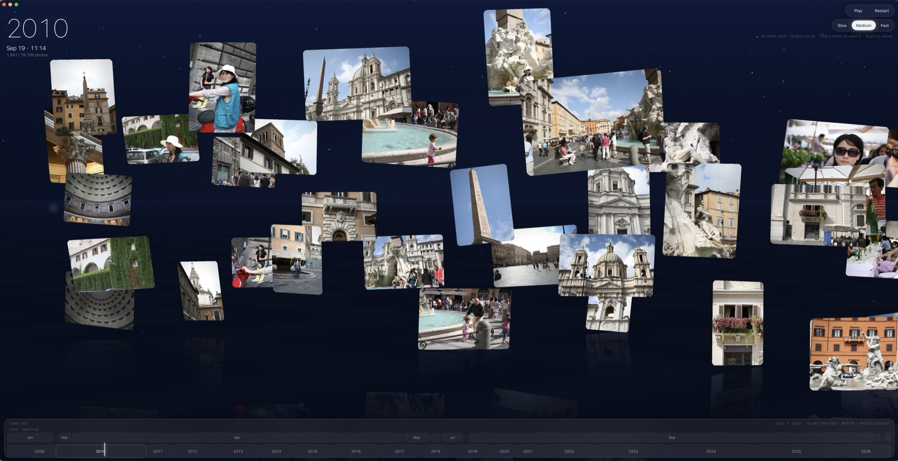

# Photo River

A slow river of your photos.



Photo River turns twenty years of an Apple Photos library into a cinematic, local-first Mac app. Nothing is uploaded: the app reads your library in place through Apple's PhotoKit (dates, locations, the previews Photos already keeps) and draws it with Metal.

One view exists today:

- **Time River**: photo cards drift under a starfield, oldest to newest, with constant photo density. The river's coordinate is the photo index, not the clock, so a trip with 400 photos in three days flows slowly and an empty winter month passes in a blink. Scroll to zoom, drag (or two-finger swipe) to scrub, pull out the timeline at the bottom to jump to a year or month, and click a card: the river stops and the full image opens. ←/→ step through neighbouring photos; click or Esc returns to the river.

The app also ships with a synthetic sample library (`data/sample/photos.json`, 20,613 fake photos over 2006–2026) so you can see it work without your own photos.

The product thinking behind this, and the backlog of ideas, is in [docs/PRD.md](docs/PRD.md). The sample's data format is in [docs/DATA.md](docs/DATA.md).

## Requirements

- macOS 14 or later with the Photos app.
- Apple's Command Line Tools (Swift and the macOS SDK). Xcode is not needed:

  ```sh
  xcode-select --install
  ```

## Build and run

```sh
git clone https://github.com/ctchuang/photo-river.git
cd photo-river
make run        # build build/PhotoRiver.app and open it on your Photos library
make sample     # the same app on the synthetic sample
```

The first time, macOS asks for access to your photos. If you decline, the app falls back to the synthetic sample; you can grant access later in System Settings → Privacy & Security → Photos.

`make app` only builds. The app is signed ad hoc, so after a rebuild macOS may ask for photo access again.

Cards use the small previews Photos already keeps; nothing is downloaded for them. Opening a photo whose original lives only in iCloud downloads it, with a progress bar.

## Optional: JSON exporter

`scripts/export_photos.py` writes the library's metadata (and with `--full`, people, scene labels, aesthetic scores and camera models) to `data/photos.json` in the format of [docs/DATA.md](docs/DATA.md), for analysis or future views. The app does not need it. It runs in a uv-managed venv and needs Full Disk Access for your terminal:

```sh
brew install uv
uv sync
uv run scripts/export_photos.py --full > data/photos.json
```

See the docstring at the top of the script for all flags (`--movies`, `--thumbs`, `--library`).

## Repository layout

```
mac/        the app: a Swift package (Metal river, SwiftUI overlay, PhotoKit) and its Info.plist
Makefile    builds and packages mac/ into build/PhotoRiver.app
data/       the synthetic sample, and your own export if you make one (ignored by git)
scripts/    gen_synthetic.py (fake library), export_photos.py (optional Apple Photos → JSON)
docs/       PRD and data format
```

## Privacy

The app reads your Photos library read-only and makes no network requests of its own; the only downloads are originals that PhotoKit fetches from your own iCloud when you open a photo. The optional exporter writes `data/photos.json` and `data/thumbs/`, which `.gitignore` keeps out of the repository.

## License

[MIT](LICENSE).
